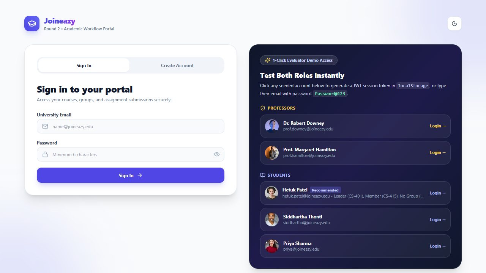
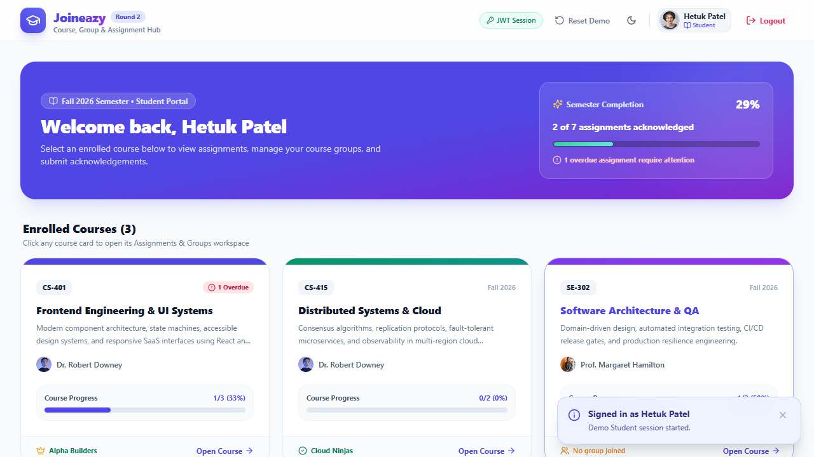
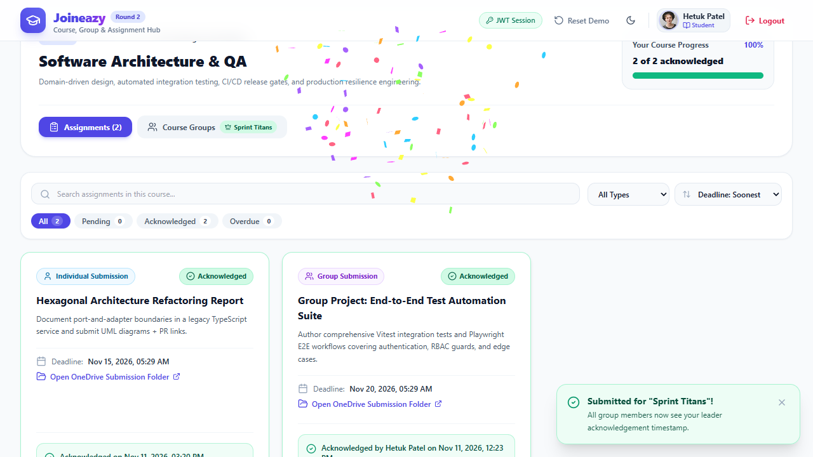
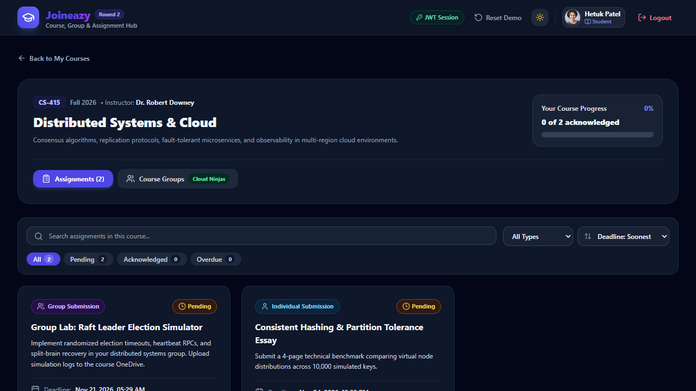
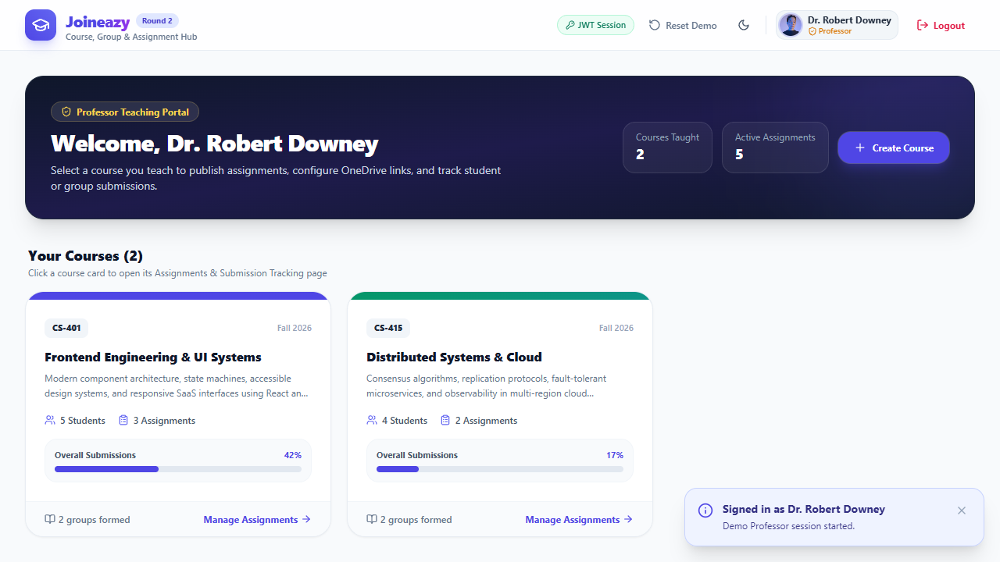
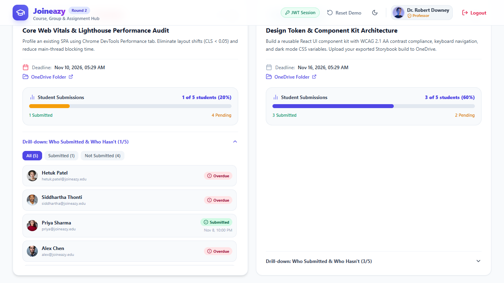
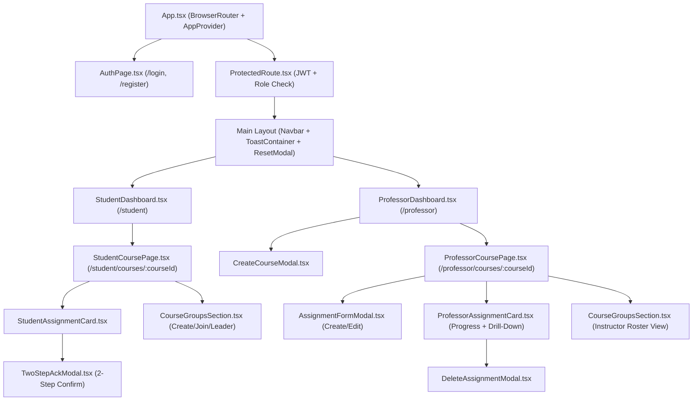

# Joineazy — Student, Group & Assignment Management Hub (Round 2)

A modern, responsive React + TypeScript + Tailwind CSS platform built for the **Joineazy Frontend Intern Round 2** evaluation. It enables **Professors** to create courses, publish individual or group assignments, and monitor submission completion with drill-down rosters — while empowering **Students** to manage course groups, enforce group-leader-only acknowledgement rules, and track deadlines cleanly across desktop, tablet, and mobile viewports.

---

## Key Features & Functional Coverage

### 1. Role-Based Authentication & Simulated JWT Session
- **Login & Registration** with full client-side validation (required fields, email format, minimum password length, duplicate account detection, and password visibility toggle).
- **Role Selection** on Registration (`Student` or `Professor`) dynamically routes users to their dedicated portal (`/student` or `/professor`).
- **Simulated JWT Storage**: Generates and verifies a `base64url`-encoded JWT payload stored in `localStorage` (`joineazy_jwt`). Logging out clears the token, and `<ProtectedRoute>` enforces both authentication and role authorization.
- **1-Click Evaluator Demo Access**: Instant sign-in buttons for pre-seeded Professor and Student personas (including Group Leader, Non-Leader Member, and No-Group scenarios).

### 2. Professor Workflow
- **Teaching Dashboard**: Displays course cards with enrolled student counts, formed group counts, active assignments, and overall submission rates, plus a **Create Course** modal.
- **Assignment Creation & Management**: Create, edit, and delete assignments specifying `title`, `description`, `deadline` (date & time with quick presets `+3d`, `+1w`, `+2w`), `OneDrive link`, and `submissionType` (`Individual` or `Group`).
- **Submission Analytics & Drill-Down Roster**:
  - Live progress bars showing submitted vs. total students (for individual tasks) or submitted vs. total groups (for group tasks).
  - Overdue indicators and ungrouped-student alerts.
  - Expandable **Drill-down: Who Submitted & Who Hasn't** list with `All` / `Submitted` / `Not Submitted` filter pills, exact leader/student timestamps, and submission links/notes.

### 3. Student & Group Workflow
- **Enrolled Courses Dashboard**: Visual semester progress summary and course cards displaying assignment counts, overdue warnings, and your active group/leader status in each course.
- **Group Management (`CourseGroupsSection`)**:
  - Create a new group inside any course (the creator automatically becomes **Group Leader**).
  - Join or leave existing groups, view all group members with clear **Leader** badges.
- **Submission Rules & Two-Step Acknowledgement**:
  - **No Group**: Group assignments display `"You are not part of any group. Create or join one to submit this assignment."` with a direct CTA button to open the Course Groups tab.
  - **Group Leader Lock**: Only the **Group Leader** can acknowledge a group assignment; once confirmed, all members see `"Acknowledged by [Leader] on [date and time]"`. Non-leader members see an informational lock banner naming their group leader.
  - **Two-Step Modal (`TwoStepAckModal`)**: Requires confirming `"Yes, I have submitted"` (with optional OneDrive link & note) followed by a final confirmation step that records the ISO timestamp and celebrates completion.

### 4. UI/UX Polish
- Search, submission-type filter (`All` / `Individual` / `Group`), status filter, and sorting (`Deadline`, `Title`) on both Student and Professor course pages.
- Accessible **Dark Mode** persisted in `localStorage`.
- Toast notifications, empty states, loading skeletons, and full mobile/tablet/desktop responsiveness (`390px` to desktop).

---

## Screenshots

| Authentication & Demo Portal | Student Courses Dashboard |
| :---: | :---: |
|  |  |

| Group Leader Two-Step Acknowledgement | Accessible Dark Mode |
| :---: | :---: |
|  |  |

| Professor Teaching Portal | Submission Drill-Down Tracking |
| :---: | :---: |
|  |  |

---

## Design Choices & Technical Architecture

- **State & Persistence (`AppContext` + `authService`)**: Centralized React Context persists users, courses, groups, and assignment acknowledgements in `localStorage` so evaluators can test multi-user interactions (e.g., submitting as a student leader, logging out, and inspecting live progress as the professor) in a single browser session — with a one-click **Reset Demo** modal to restore initial seed data anytime.
- **Strict Role & Group Integrity**: Group membership and leadership are derived deterministically per course (`groups` state), ensuring a student cannot belong to multiple groups in the same course and non-leaders are blocked at both UI and action layers from overriding group acknowledgements.
- **Design System**: Clean card hierarchy, subtle glassmorphism headers, semantic status pills (emerald = acknowledged/submitted, amber = pending/no-group warning, rose = overdue), and color-coded progress bars with Tailwind CSS v3.

### Component Structure Diagram



---

## Demo Login Credentials

All seeded accounts share the password: **`Password@123`** (or use the **1-Click Evaluator Demo Access** cards on `/login`).

| Role | Name | Email | Highlight Scenario |
| :--- | :--- | :--- | :--- |
| **Professor** | Dr. Robert Downey | `prof.downey@joineazy.edu` | Teaches `CS-401` & `CS-415` — view drill-down tracking & publish assignments |
| **Professor** | Prof. Margaret Hamilton | `prof.hamilton@joineazy.edu` | Teaches `SE-302` — monitor QA & architecture groups |
| **Student** | Hetuk Patel | `hetuk.patel@joineazy.edu` | **Group Leader** in `CS-401`, **Member** in `CS-415`, **No Group** in `SE-302` |
| **Student** | Siddhartha Thonti | `siddhartha@joineazy.edu` | **Group Leader** in `CS-415` (`Cloud Ninjas`) |
| **Student** | Priya Sharma | `priya@joineazy.edu` | **Group Leader** of `Pixel Pioneers` (`CS-401`), `Consensus Crew` (`CS-415`), & `QA Legends` (`SE-302`) |
| **Student** | Alex Chen | `alex@joineazy.edu` | Member of `Pixel Pioneers` (`CS-401`), `Consensus Crew` (`CS-415`), & `QA Legends` (`SE-302`) |
| **Student** | Ananya Gupta | `ananya@joineazy.edu` | Member of `QA Legends` (`SE-302`) |

---

## Local Setup & Commands

```bash
# 1. Navigate to the React frontend directory
cd frontend

# 2. Install dependencies
npm install

# 3. Start local development server
npm run dev

# 4. Run automated integration tests (Vitest + React Testing Library)
npm test

# 5. Create production bundle
npm run build
```

---

**Author:** Hetuk Patel  
**Submission:** Joineazy Frontend Intern — Round 2
